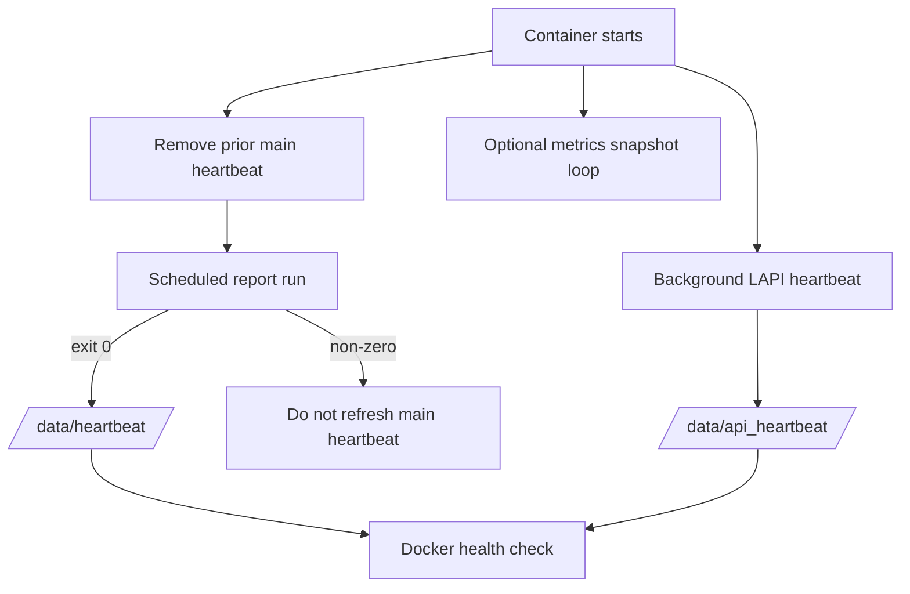

# Health Checks

Both images define a `HEALTHCHECK`. In both cases it verifies that a heartbeat
file is **recent**, and in both cases the heartbeat is written only after a
successful run — which is what makes a repeatedly failing export or report run
visible instead of silently green.

## crowdsec-abuse-reporter

Two files must **both** be fresh, and the helper loops must be alive:

| File | Written by | Staleness limit |
|---|---|---|
| `/data/heartbeat` | The entrypoint, only after an exit-0 main run | `HEALTHCHECK_MAX_AGE_SECONDS`, default `run interval + max jitter + 7200` (`28800` at the 6 h default) |
| `/data/api_heartbeat` | `python -m app.heartbeat` in the background loop | `API_HEARTBEAT_MAX_AGE_SECONDS`, default `API_HEARTBEAT_INTERVAL + 400` (`700` at the default) |

The entrypoint derives all limits once at start and writes them to
`/tmp/health_limits`; the check reads that file, and a missing file means
`unhealthy`. An explicitly set `*_MAX_AGE_SECONDS` replaces the derived value.

In addition the check verifies that the background loops are running. Each loop
records `<pid> <start time>` in a pid file on the `/tmp` tmpfs; the check fails when
the process is gone, a zombie, or has a different start time (a reused pid):

| File | Loop | Checked |
|---|---|---|
| `/tmp/api_heartbeat.pid` | LAPI heartbeat | always |
| `/tmp/metrics.pid` | Metrics snapshots | only when `METRICS_BACKEND` is set and not `none` |
| `/tmp/metrics_heartbeat` | Metrics snapshots | touched after each successful snapshot; must be younger than `METRICS_HEARTBEAT_MAX_AGE_SECONDS` (optional, default `10 * METRICS_INTERVAL + 300`, i.e. `900` at the default interval of `60`) |

A metrics backend outage therefore only turns the container `unhealthy`; it never
restarts it. A loop that **dies** is different: the entrypoint logs an `ERROR`
naming the loop, stops all other jobs and exits `1`, so the restart policy
restarts the container. A failing Python call inside a loop (LAPI, SMTP or backend
unreachable) does not end the container.

Check parameters: `--interval=5m --timeout=10s --start-period=7m --retries=3`.

The two files answer different questions. The main heartbeat says "processing
completed successfully at some point within the reporting interval", which for a
six-hour schedule is necessarily a coarse signal. The LAPI heartbeat runs every
`API_HEARTBEAT_INTERVAL` seconds (default `300`) and detects a prolonged LAPI
outage *between* main runs, long before the main heartbeat would go stale.

The entrypoint removes the persisted main heartbeat at container startup, so a
successful run from an earlier container cannot make the new instance healthy.
The current instance creates that heartbeat only after a successful report run.

**Reporter heartbeat lifecycle:** the diagram shows which processes update each
health signal and how Docker combines them into the healthy status.

!!! danger "Never touch `/data/heartbeat` unconditionally"
    The entrypoint refreshes it only when `run.py` exits `0`. Touching it on every
    loop iteration would keep the health check green while processing failed
    repeatedly — which is precisely the failure the check exists to catch.

Note that `run.py` exits non-zero only for **hard** failures: configuration, GeoIP
cold start, database init, LAPI fetch, database errors, and metrics failures
(lost or dropped points, an unverifiable QuestDB dedup gate, a TTL that cannot be
set). Per-report DNS or SMTP
failures still exit `0`, so they do not turn the container unhealthy. Use the
metrics backend or the logs to see those.

## crowdsec-metrics-exporter

One file:

| File | Written by | Staleness limit |
|---|---|---|
| `/tmp/state/heartbeat` | The entrypoint, only after `main.py` exits `0` | `HEALTHCHECK_MAX_AGE_SECONDS`, default `900` (15 min) |

Check parameters: `--interval=5m --timeout=10s --start-period=3m --retries=3`.

`main.py` exits `1` when the LAPI fetch or a backend write fails (including a QuestDB server that is not 10.x, an unverifiable QuestDB dedup gate or a TTL that cannot be set), so
the container turns unhealthy once exports keep failing past the staleness limit.

### The heartbeat lives on tmpfs deliberately

`/tmp/state` is a fixed path on the container's tmpfs — no host mount, not
configurable, because there is nothing to relocate.

!!! note "A restarted container is unhealthy until its first successful export"
    That is intentional. Previously a stale heartbeat on persistent storage could
    mask a broken start for up to `HEALTHCHECK_MAX_AGE_SECONDS`. The
    `--start-period` covers the legitimate startup window instead.

## Interpreting an unhealthy container

| Symptom | Likely cause |
|---|---|
| Unhealthy shortly after start | Still inside `--start-period`, or the first run has not succeeded yet |
| Exporter unhealthy after ~15 min | LAPI unreachable, a TLS handshake rejected, QuestDB not 10.x, QuestDB dedup unverified, or backend writes rejected |
| Reporter unhealthy on the API heartbeat only | LAPI outage; main processing may still be fine |
| Reporter unhealthy on both | Main runs are failing hard — check configuration and the database |
| Reporter unhealthy with metrics enabled, heartbeats fresh | Metrics backend unreachable: no snapshot succeeded within `METRICS_HEARTBEAT_MAX_AGE_SECONDS` |

See [Troubleshooting](../troubleshooting.md) for the diagnostic steps.
